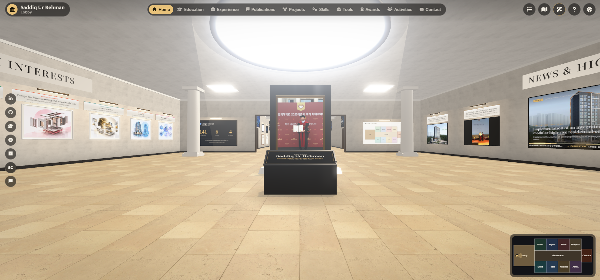

<div align="Left">

---

## 📖 Overview

The academic portfolio of Saddiq Ur Rehman, a researcher in Building Information Modeling (BIM), extended reality and AI for the construction industry, presented as a walk-through 3D museum built with three.js. Every item in `data/*.json` is hung as an exhibit; click any of them to read its full story.

## 🏛️ The Museum

- **Lobby (Home)**: a portrait column, About Me wall texts, research interests, Google Scholar metrics, the museum directory, and a wall-mounted **news TV** that cycles through every news item (photo with a slow Ken Burns drift, headline, progress bar and a scrolling ticker), flanked by the four latest highlights
- **Grand Hall**: gallery banners above every door, the news timeline and the most-cited works
- **Galleries I–VIII**: Education (diplomas), Experience, Publications (journal papers hang as their **journal's cover**, the rest as a poster generated from the paper's topics, plus a reading desk with search and filters), Projects, Skills (columns that rise to their proficiency as you walk in), Tools (screens), Awards (gently swaying medals and framed certificates) and Activities
- **Activities' hologram projector**: the co-authors as a turning **network** with sparks running along its links, or as a **holographic globe** of glowing land with a marker on each partner country, arcs from Korea, and cards beside it listing the co-authors there. The globe turns on its own; drag it to spin and tilt it. Switch with the HUD control (click Network, World map, or the Hologram label to flip), the console beside the dais, the collaboration panel or `V`
- **Contact**: information desk, location map, profiles and the visitor counter

Every work has its caption above it. The **catalogue** button lists every work as text (the accessible view).

**Controls:** drag with the left or right mouse button to look around, standing still or walking; `W` `A` `S` `D` or the arrow keys to walk (`Shift` to hurry); scroll to step; click the floor to walk there; `1`–`0` jump to a room, `M` map, `C` catalogue, `H` help, `Esc` closes panels. Touch screens get a joystick; a finger drag looks around. The sun/moon button switches between day and night lighting, and the sparkle button switches graphics between **high** (shadows, bloom, sharper textures) and **fast** (for phones and small GPUs; the default there). Gallery links such as `#publications` (and the old `#software`) still work.

### Rendering

- **Materials**: scanned CC0 surfaces from [Poly Haven](https://polyhaven.com) (herringbone parquet, limestone tiles, plaster, wool) with colour, normal and roughness maps, mapped in real-world metres
- **Lighting**: a skylight key that casts soft shadows and follows the visitor, hemisphere and environment bounce, baked ambient occlusion along every wall and under every pedestal, brass picture lights with light pools on the walls, and a shaft of daylight under the lobby's oculus
- **Post-processing** (high quality): multisampled HDR, bloom on lamps, light panels and holograms, and a highlight roll-off that leaves artwork colours untouched
- **Sharp exhibits**: wall texts are painted supersampled, and photos are sized to their frame, so close-ups stay crisp without filling GPU memory; textures load and unload by distance
- Rendering is on demand: frames are drawn only while something moves or animates nearby

## 🏗️ Structure

```text
|-- index.html              # The museum page (HUD, panels, catalogue, loader)
|-- data/                   # Everything the museum shows
|   |-- profile.json        # Name, About Me, research interests, education, reviewing, contact, social links
|   |-- news.json           # News; the first 4 are the lobby highlights, all of them play on the TV
|   |-- publications.json   # Journals, conferences, Korean conferences, reports
|   |-- venues.json         # Cover image per journal/conference name
|   |-- collaborations.json # Co-authors by author, organisation and country (with map coordinates)
|   |-- world-dots.json     # Generated: land cells for the hologram world map
|   |-- museum-textures.json # Generated: sizes of the gallery copies of every image
|   |-- scholar.json        # Google Scholar metrics (refreshed automatically)
|   `-- ...                 # certificates, experience, projects, seminars, skills, software
|-- scripts/
|   |-- update-scholar.mjs        # Reads the live Scholar profile, rewrites scholar.json
|   |-- build-museum-textures.py  # Gallery-sized copies of every image
|   `-- build-world-map.py        # Rasterises Natural Earth land into world-dots.json
|-- assets/
|   |-- css/museum.css      # HUD, panels, catalogue and loader
|   |-- js/museum/          # world (building, lights), exhibits, art (canvas painters),
|   |                       # controls, panels, post (bloom pipeline), data, main
|   |-- museum/             # Generated gallery copies + textures/ (Poly Haven surfaces)
|   |-- images/             # Originals: certificates, covers, news, profile, projects, venues, ...
|   |-- icons/, logos/      # Skill, social and organisation logos
`-- Readme.md
```

## 🚀 Updating the Content

The museum re-hangs itself from the JSON files; walls make room for new items automatically.

- **`data/news.json`**: newest at the top. The first 4 entries are the lobby highlights; every entry plays on the lobby TV and the rest also hang in the Grand Hall. Properties include `type`, `date`, `icon`, `title`, `summary`, `details`, `link`/`linkLabel`, `images` and an optional `thumbnail` (used as the TV picture).
- **`data/publications.json`**: group papers under `journals`, `conferences`, `korean_conferences` or `technical_reports`, with `impactFactor`, `quartile`, `category`, `doi` and `badges`.
- **`data/venues.json`**: to show a venue's cover, save the image in `assets/images/venues/` and add `"Exact journal name": "assets/images/venues/file.jpg"` under `covers`. Papers at venues without a cover get a generated poster.
- **`data/collaborations.json`**: co-authors with `papers`, `university` or `Industry`, `country`; `byCountry` carries `lat`/`lng` for the hologram's pins.
- **`data/profile.json`, `projects.json`, `experience.json`, `skills.json`, `certificates.json`, `seminars.json`, `software.json`**: the rest of the portfolio.
- **`data/scholar.json`**: **do not edit by hand**; the workflow below rewrites it.
- **Images**: after adding or replacing one, run `python scripts/build-museum-textures.py` (needs Pillow). It writes web-sized copies (long edge 2048 px) to `assets/museum/` and their sizes to `data/museum-textures.json`. An image without a copy still shows; the museum falls back to the original.

### Google Scholar Metrics (automated)

`.github/workflows/update-scholar.yml` runs `scripts/update-scholar.mjs` every 6 hours (00:17, 06:17, 12:17, and 18:17 UTC). The script reads the public profile, and commits `data/scholar.json` only when a number actually changes - which republishes the Pages site, so every visitor gets the new figures on their next load.

- Point it at a different profile by editing `SCHOLAR_ID` in the script (and the `scholarId` in `data/scholar.json`).
- Run it on demand from **Actions → Update Google Scholar metrics → Run workflow**.
- Requires **Settings → Actions → General → Workflow permissions** to be set to *Read and write permissions* so the job can push.
- If Google answers with a captcha, the run logs a warning and leaves the existing numbers untouched; the next run picks it up.
- GitHub pauses scheduled workflows in repos with no activity for 60 days - just re-enable it from the Actions tab if that ever happens.

### Running Locally

The page loads JSON with `fetch`, so serve the folder rather than opening the file:

```bash
python -m http.server 8000
# then open http://localhost:8000
```

### Deploy

Push to the `main` branch with **GitHub Pages** enabled in the repository settings.

### Enable the Date-Stamping Hook

A `pre-commit` hook keeps every "last updated" date current automatically. Git does not enable hooks on clone, so run this once per clone:

```bash
git config core.hooksPath .githooks
```

On each commit it stamps today's date into the JSON-LD `dateModified` and every `<lastmod>` in `sitemap.xml`. Skip it for a single commit with `SKIP_DATESTAMP=1 git commit ...`.

## 🌐 Browser Support

Any current browser with WebGL 2: Chrome, Edge, Firefox and Safari (desktop and mobile).

## 🙏 Credits

- Surface textures: [Poly Haven](https://polyhaven.com) (CC0)
- World map outlines: [Natural Earth](https://www.naturalearthdata.com) via [world-atlas](https://github.com/topojson/world-atlas) (public domain)
- Journal covers belong to their publishers and are shown to identify where the papers appeared
- 3D engine: [three.js](https://threejs.org)

## 📞 Contact

**Saddiq Ur Rehman**

- 📧 Email: [saddiqurrehman@khu.ac.kr](mailto:saddiqurrehman@khu.ac.kr)
- 🔗 LinkedIn: [saddiq-ur-rehman](https://www.linkedin.com/in/saddiq-ur-rehman-b79212138/)
- 💻 GitHub: [isaddiq](https://github.com/isaddiq)

## 📄 License

This project is licensed under the MIT License - see the [LICENSE](LICENSE) file for details.

---

<div align="center">
