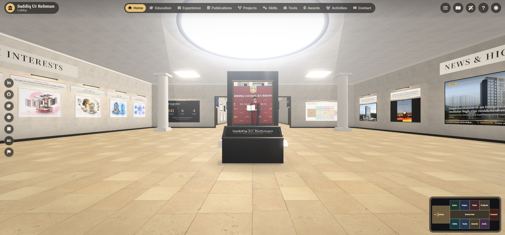

<div align="Left">

---

## 📖 Overview

The academic portfolio of Saddiq Ur Rehman, a researcher in Building Information Modeling (BIM), extended reality and AI for the construction industry, presented as a walk-through 3D museum built with three.js. Every item in `data/*.json` is hung as an exhibit; click any of them to read its full story.

## 🏛️ The Museum

- **Lobby (Home)**: a research centrepiece on a round dais (one building model, cycling through BIM, robotics, XR and digital twin), an oculus open to the sky (clouds by day, stars by night) with dust drifting in its shaft of light, turned stone columns, a portrait column, About Me wall texts, research interests, Google Scholar metrics, the museum directory, and a wall-mounted **news TV** that cycles through every news item (photo with a slow Ken Burns drift, headline, progress bar and a scrolling ticker), flanked by the four latest highlights
- **Grand Hall**: gallery banners above every door, the news timeline and the most-cited works
- **Galleries I–VIII**: Education (diplomas), Experience, Publications (journal papers hang as their **journal's cover**, the rest as a poster generated from the paper's topics, plus a reading desk with search and filters), Projects (with five research demonstrations), Skills (columns that rise as you walk in; each skill's panel lists the tools, projects and papers it appears in), Tools (screens, with four research demonstrations), Awards (medals under glass vitrines, swaying gently, and framed certificates) and Activities (click any co-author in the network for the papers written together)
- **Activities' hologram projector**: the co-authors as a turning **network** with sparks running along its links, or as a **holographic globe** of glowing land with a marker on each partner country, arcs from Korea, and cards beside it listing the co-authors there. The globe turns on its own; drag it to spin and tilt it. Switch with the HUD control (click Network, World map, or the Hologram label to flip), the console beside the dais, the collaboration panel or `V`
- **Contact**: information desk, location map, profiles and the visitor counter

### Research demonstrations

Ten animated, interactive miniatures show how the research methods work. Each stands on a plinth with a reading label that names its stages and highlights the current one; click it to replay, pause or step through the stages from its panel. They are labelled as **conceptual simulations**: they illustrate methods and never show measured results.

| Where | Demonstration | What happens |
| --- | --- | --- |
| Lobby | One model, four ways of working | An eight-storey tower built element by element (slabs, columns, core, glazing, mullions, roof plant) on a planted plaza. Its storeys part into an exploded view and are named in turn (BIM); a four-wheeled rover laps the dais while its lidar builds a point cloud of the façades (robotics); a registration ring turns the same elements into a hologram with anchored annotations (XR); rooms light up through a working day while data runs up a riser and across to a small live copy (digital twin) |
| Gallery IV | BIM | A three-storey frame assembles in construction order, with its core, mullioned curtain walls, entrance doors and roof parapet; click any element for its IFC class, storey, material, size and property-set values |
| Gallery IV | Construction informatics | Truck, tower crane and a framed building report to a site dashboard; the slung load swings like a pendulum as the jib slews; a late delivery opens a gap between planned and actual progress, and re-sequenced lifts close it |
| Gallery IV | Construction robotics | A six-joint arm (dress pack, padded gripper, a signal tower on its cabinet) lays a brick wall; each move is planned (dotted tool path), then executed with minimum-jerk motion solved by inverse kinematics |
| Gallery IV | DfMA | Panels form a module on the factory bed; a braced gantry lifts each one on four slings, carries it (with sway) and stacks six modules |
| Gallery IV | AI for construction | Three typed questions are interpreted into IFC classes and properties, matching elements are retrieved and highlighted, and answered |
| Gallery VI | BIM interoperability | IFC elements pass through a mapping gate, are tessellated for the engine, gain colliders and a navigation mesh, and are checked element by element |
| Gallery VI | Robot navigation | A floor plan becomes an occupancy grid; A* (computed live, explored cells shown) plans a route; a person walks into a doorway and the robot (wheels turning, lidar beam sweeping) replans |
| Gallery VI | Extended reality | A registration plane turns a physical model into a hologram; a headset orbits and spatial overlays light up where it looks |
| Gallery VI | Digital twin | A simulated working day: people appear at the windows as rooms fill, lights and CO₂ change, the twin colours each room by air quality and sends a ventilation boost back |

Research-interest panels in the lobby link to their demonstration.

The models are built like architectural presentation models at about 1:16: each sits on an MDF base board with scale figures, trees and soft contact shadows, and every surface is textured (`surfaces.js`): board-marked concrete, precast panels, brick, curtain walling, office and modular façades, worn yellow plant paint, crane lattice, timber, clay, asphalt with lane markings, soil, grass, floor tiles and plaster. The textures are painted procedurally (nothing to download) and projected triplanar in each part's own space, so they keep their real size on every face, with a fine relief that fades out where it would shimmer.

### Residents

Two **cleaning robots** look after the lobby, Grand Hall and contact room: each leaves its charging dock, plans paths over the walkable grid, spirals over a spot, waits for anyone in its way, and drives home to charge when its battery is low (the dock shows the charge). The stone it has mopped stays damp behind it and dries over half a minute; it eases into turns, rides up onto the hall's runner, and its dock is plugged into a wall socket. Click a robot to see what it is doing.

Every work has its caption sign-written on the wall above it, and wall texts, gallery introductions and the big lettering are painted straight onto the plaster: they take the wall's light, shadows and texture, with a little wear in the paint.

**Visitors** (ten on High, four on Fast, joining one by one as they load): realistic people (businesswomen and businessmen, and visitors in everyday clothes) wander the galleries with motion-captured walks, stop a few steps back from works, look around, and now and then raise a camera to take a photo, glancing about as they stand. They ease up to their pace and down from it, slow and lean into corners, take straight lines across a room instead of zigzags, and their walk cycle always matches the ground they cover, so feet do not slide. They walk around furniture and through the doors, give way to you and to each other, never stand inside one another, and only those near you and on screen are animated.

The **catalogue** button lists every work as text (the accessible view), and the arrow button at the top right opens the page-based portfolio at [isaddiq.github.io](https://isaddiq.github.io).

**Controls:** drag with the left or right mouse button to look around, standing still or walking; `W` `A` `S` `D` or the arrow keys to walk (`Shift` to hurry); scroll to step; click the floor to walk there (the walk follows a planned path round furniture, plinths and walls, never through them); walk up to a work and press `Enter` (or tap the prompt) to read about it; `R` levels the view; `U` turns the optional relaxing music on or off (generative ambient pads, a soft bass and bell notes in a hall reverb, synthesised in the browser, plus a soft motor hum near working demonstrations; off until you turn it on); `1`–`0` jump to a room, `M` map, `C` catalogue, `H` help, `Esc` closes panels. Touch screens get a joystick; a finger drag looks around. `N` and `P` (or the buttons at the foot of an open panel) walk on to the next or previous work in the room. Hovering a work closes a set of brackets around it. The **Lighting** switch (bottom left) sets day or night, and the **Graphics** switch sets **High** (shadows, bloom, mirrored floors, sharper textures) or **Fast** (for phones and small GPUs; the default there). Gallery links such as `#publications` (and the old `#software`) still work.

### Rendering

- **Materials**: scanned CC0 surfaces from [Poly Haven](https://polyhaven.com) (herringbone parquet, limestone tiles, plaster, wool) with colour, normal and roughness maps, mapped in real-world metres
- **Lighting**: a skylight key that casts soft shadows and follows the visitor, hemisphere and environment bounce, baked ambient occlusion along every wall and under every pedestal, baked pools of light on the floor under every ceiling light, a laylight and a rail of track spots in each gallery, brass picture lights with light pools on the walls, and a shaft of daylight under the lobby's oculus
- **Polished floors** (high quality): one planar reflection shared by every floor, blurred by roughness and strengthened towards the horizon (`reflect.js`)
- **Post-processing** (high quality): multisampled HDR, bloom on lamps, light panels and holograms, a highlight roll-off that leaves artwork colours untouched, and a fine dither against banding
- **Sharp exhibits**: wall texts are painted supersampled, and photos are sized to their frame, so close-ups stay crisp without filling GPU memory; textures load and unload by distance
- **Day and night** ease into each other over a second and a half; at night the architectural and picture lights take over from the skylight
- **Public rooms**: a honed stone dado with a bronze cap, bronze inlay rings under the oculus; a natural ~60° vertical field of view on wide screens
- **Models in the round**: one gallery spot follows the visitor to the nearest demonstration and casts crisp shadows on it; with a demonstration's panel open the view drifts slowly from side to side around the model (any movement of your own ends it), and the edge of its base lights up at each new stage
- **Framed works** come a few centimetres off the wall while you point at them or stand before them
- **Room culling** (`cull.js`): only what can be seen through the doorways is drawn, so the galleries behind a wall cost nothing; shaders are compiled in parallel while the loader is up
- Rendering is on demand: frames are drawn only while something moves or animates nearby, nothing runs while the tab is hidden, and demonstrations, people and residents off screen keep time without being drawn

## 🏗️ Structure

```text
|-- index.html              # The museum page (HUD, panels, catalogue, loader)
|-- data/                   # Everything the museum shows
|   |-- profile.json        # Name, About Me, research interests, education, reviewing, contact, social links
|   |-- news.json           # News; the first 4 are the lobby highlights, all of them play on the TV
|   |-- publications.json   # Journals, conferences, Korean conferences, reports
|   |-- venues.json         # Cover image per journal/conference name
|   |-- collaborations.json # Co-authors by author, organisation and country (with map coordinates)
|   |-- world-dots.json     # Generated: land cells for the hologram world map
|   |-- museum-textures.json # Generated: sizes of the gallery copies of every image
|   |-- scholar.json        # Google Scholar metrics (refreshed automatically)
|   `-- ...                 # certificates, experience, projects, seminars, skills, software
|-- scripts/
|   |-- update-scholar.mjs        # Reads the live Scholar profile, rewrites scholar.json
|   |-- build-museum-textures.py  # Gallery-sized copies of every image
|   |-- build-world-map.py        # Rasterises Natural Earth land into world-dots.json
|   `-- build-visitors.py         # The visitors (Rocketbox people) and their motion clips
|-- assets/
|   |-- css/museum.css      # HUD, panels, catalogue and loader
|   |-- js/museum/          # world (building, lights), exhibits, art (canvas painters),
|   |                       # controls, panels, post (bloom pipeline), reflect (mirrored floors),
|   |                       # visitors, data, main, nav (walkable grid and A*),
|   |                       # research + research-defs + demos-a/demos-b/demos-c + demo-kit (demonstrations),
|   |                       # companions (cleaning robots), cull (room culling), audio (optional music)
|   |-- museum/             # Generated gallery copies, textures/ (Poly Haven surfaces), people/ (visitors)
|   |-- images/             # Originals: certificates, covers, news, profile, projects, venues, ...
|   |-- icons/, logos/      # Skill, social and organisation logos
`-- Readme.md
```

## 🚀 Updating the Content

The museum re-hangs itself from the JSON files; walls make room for new items automatically.

- **`data/news.json`**: newest at the top. The first 4 entries are the lobby highlights; every entry plays on the lobby TV and the rest also hang in the Grand Hall. Properties include `type`, `date`, `icon`, `title`, `summary`, `details`, `link`/`linkLabel`, `images` and an optional `thumbnail` (used as the TV picture).
- **`data/publications.json`**: group papers under `journals`, `conferences`, `korean_conferences` or `technical_reports`, with `impactFactor`, `quartile`, `category`, `doi` and `badges`.
- **`data/venues.json`**: to show a venue's cover, save the image in `assets/images/venues/` and add `"Exact journal name": "assets/images/venues/file.jpg"` under `covers`. Papers at venues without a cover get a generated poster.
- **`data/collaborations.json`**: co-authors with `papers`, `university` or `Industry`, `country`; `byCountry` carries `lat`/`lng` for the hologram's pins.
- **`data/profile.json`, `projects.json`, `experience.json`, `skills.json`, `certificates.json`, `seminars.json`, `software.json`**: the rest of the portfolio.
- **`data/scholar.json`**: **do not edit by hand**; the workflow below rewrites it.
- **Images**: after adding or replacing one, run `python scripts/build-museum-textures.py` (needs Pillow). It writes web-sized copies (long edge 2048 px) to `assets/museum/` and their sizes to `data/museum-textures.json`. An image without a copy still shows; the museum falls back to the original.
- **Visitors**: `python scripts/build-visitors.py path/to/FBX2glTF` re-downloads and converts the cast listed at the top of the script (needs [FBX2glTF](https://github.com/facebookincubator/FBX2glTF/releases) and Pillow). Change `AVATARS` there to pick other Rocketbox people.

### Google Scholar Metrics (automated)

`.github/workflows/update-scholar.yml` runs `scripts/update-scholar.mjs` every 6 hours (00:17, 06:17, 12:17, and 18:17 UTC). The script reads the public profile, and commits `data/scholar.json` only when a number actually changes - which republishes the Pages site, so every visitor gets the new figures on their next load.

- Point it at a different profile by editing `SCHOLAR_ID` in the script (and the `scholarId` in `data/scholar.json`).
- Run it on demand from **Actions → Update Google Scholar metrics → Run workflow**.
- Requires **Settings → Actions → General → Workflow permissions** to be set to *Read and write permissions* so the job can push.
- If Google answers with a captcha, the run logs a warning and leaves the existing numbers untouched; the next run picks it up.
- GitHub pauses scheduled workflows in repos with no activity for 60 days - just re-enable it from the Actions tab if that ever happens.

### Running Locally

The page loads JSON with `fetch`, so serve the folder rather than opening the file:

```bash
python -m http.server 8000
# then open http://localhost:8000
```

### Deploy

Push to the `main` branch with **GitHub Pages** enabled in the repository settings.

### Enable the Date-Stamping Hook

A `pre-commit` hook keeps every "last updated" date current automatically. Git does not enable hooks on clone, so run this once per clone:

```bash
git config core.hooksPath .githooks
```

On each commit it stamps today's date into the JSON-LD `dateModified` and every `<lastmod>` in `sitemap.xml`. Skip it for a single commit with `SKIP_DATESTAMP=1 git commit ...`.

### Without WebGL

If a browser cannot run WebGL, the page lists the whole collection as plain HTML instead (biography, education, experience, publications with DOI links, projects, tools and awards), alongside links to the classic portfolio and profiles.

## 🌐 Browser Support

Any current browser with WebGL 2: Chrome, Edge, Firefox and Safari (desktop and mobile).

## 🙏 Credits

- Surface textures: [Poly Haven](https://polyhaven.com) (CC0)
- World map outlines: [Natural Earth](https://www.naturalearthdata.com) via [world-atlas](https://github.com/topojson/world-atlas) (public domain)
- Journal covers belong to their publishers and are shown to identify where the papers appeared
- Visitors: people and motion-captured animations from the [Microsoft Rocketbox](https://github.com/microsoft/Microsoft-Rocketbox) avatar library (MIT licence), converted with [FBX2glTF](https://github.com/facebookincubator/FBX2glTF)
- 3D engine: [three.js](https://threejs.org)

## 📞 Contact

**Saddiq Ur Rehman**

- 📧 Email: [saddiqurrehman@khu.ac.kr](mailto:saddiqurrehman@khu.ac.kr)
- 🔗 LinkedIn: [saddiq-ur-rehman](https://www.linkedin.com/in/saddiq-ur-rehman-b79212138/)
- 💻 GitHub: [isaddiq](https://github.com/isaddiq)

## 📄 License

This project is licensed under the MIT License - see the [LICENSE](LICENSE) file for details.

---

<div align="center">
